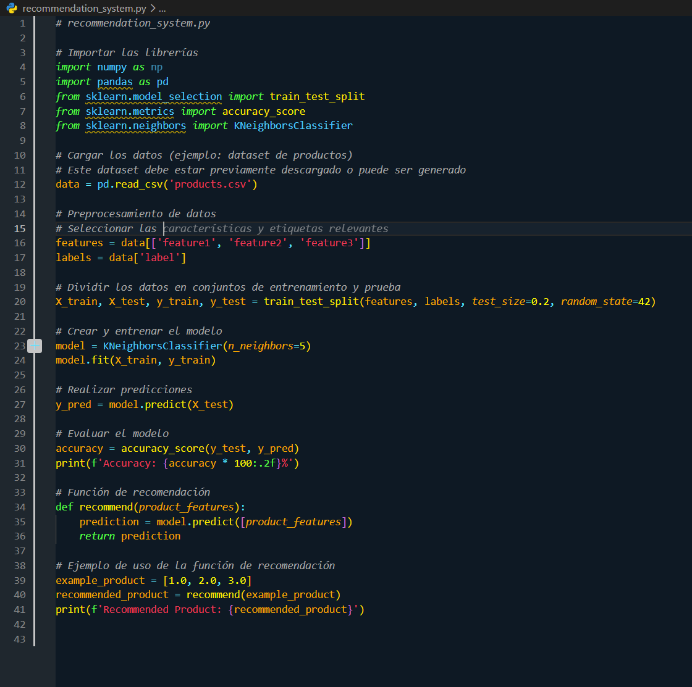

# Actividad Formativa: GitHub Copilot - Sistema de Recomendación con IA

**Autor:** Angelo Zamora  
**Institución:** INACAP  
**Repositorio:** `AI_Project`  

---

## 1. Objetivo de la Actividad
Explorar las tendencias emergentes en inteligencia artificial aplicada al desarrollo de software utilizando **GitHub Copilot** en Visual Studio Code para generar, estructurar y documentar un sistema de recomendación en Python.

---

## 2. Desarrollo Paso a Paso

### Paso 1: Configuración de GitHub Copilot y Creación del Repositorio
1. Se verificó el acceso activo a **GitHub Copilot** en la cuenta personal de GitHub.
2. Se creó un nuevo repositorio público en GitHub bajo el nombre **`AI_Project`**, inicializado con los archivos base (`README.md` y `.gitignore`).

### Paso 2: Clonación Local del Repositorio
Utilizando la terminal integrada de Visual Studio Code, se clonó el repositorio remoto al entorno local:

```bash
git clone [https://github.com/sicosis3dfx/AI_Project.git](https://github.com/sicosis3dfx/AI_Project.git)
cd AI_Project
```

### Paso 3: Desarrollo Asistido por IA (`recommendation_system.py`)
Dentro del directorio del proyecto se creó el archivo `recommendation_system.py`. Mediante comentarios descriptivos en español, **GitHub Copilot** sugirió y autocompletó la estructura del modelo de aprendizaje automático utilizando `KNeighborsClassifier` de `scikit-learn`:

* **Carga y preprocesamiento:** Lectura de datos mediante `pandas` y separación entre características (`feature1`, `feature2`, `feature3`) y etiqueta (`label`)[cite: 9].
* **Partición de datos:** División en conjuntos de entrenamiento (80%) y prueba (20%) con `train_test_split`.
* **Entrenamiento y evaluación:** Ajuste del clasificador KNN (`n_neighbors=5`) y cálculo de exactitud con `accuracy_score`.
* **Función de inferencia:** Implementación de la función `recommend(product_features)` para predecir recomendaciones sobre nuevos productos.

#### Evidencia de Autocompletado en Visual Studio Code
En la siguiente captura se observa el funcionamiento de GitHub Copilot sugiriendo código en tiempo real dentro del editor:



---

## 3. Estructura del Proyecto

```text
AI_Project/
├── img/
│   └── copilot_sugerencia.png   # Evidencia del uso de GitHub Copilot en VS Code
├── recommendation_system.py     # Script del sistema de recomendación generado con IA
└── README.md                    # Documentación del proceso de laboratorio
```

---

## 4. Control de Versiones y Subida a GitHub
Una vez completado el código y la documentación, se registraron y subieron los cambios al repositorio remoto mediante los siguientes comandos:

```bash
git add .
git commit -m "Add recommendation system example and documentation"
git push -u origin main
```